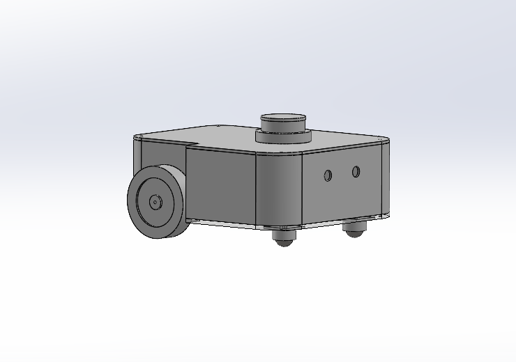
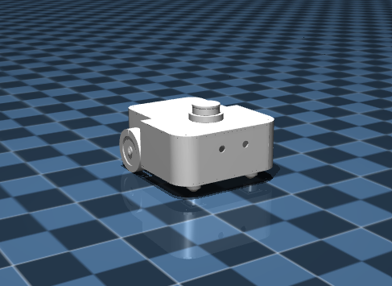
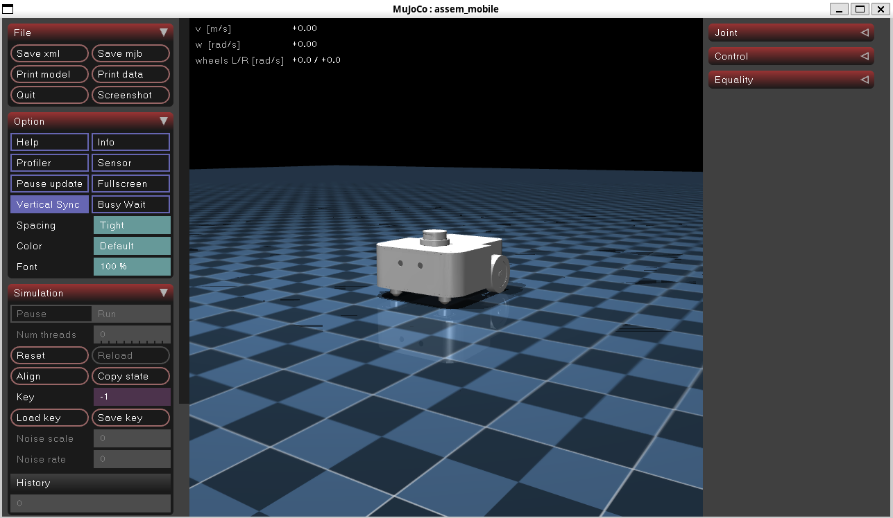

# CanBot teleop

Keyboard teleoperation of **CanBot**, a small differential-drive robot designed in SolidWorks and
simulated in **MuJoCo** with plain Python (no ROS).

> 🎬 **Demo video:** _link coming soon_ <!-- replace with the video link, e.g. YouTube / Google Drive -->

| SolidWorks design | MuJoCo simulation |
|---|---|
|  |  |

---

## Workflow: from CAD to a drivable simulation

```
 1. SolidWorks assembly  ──►  2. sw2robot export  ──►  3. build_scene.py  ──►  4. teleop.py
    (all parts designed        ├─ ROS 2 package           (makes the export       (keyboard driving
     and assembled)            │  (URDF + meshes)          drivable: collision,    in the MuJoCo
                               └─ MuJoCo MJCF  ──────►     motors, floor)          viewer)
                                  (+ meshes)               = robot_scene.xml
```

1. **Design in SolidWorks.** Every part of the robot was designed and put together in a
   SolidWorks assembly (`assem_mobile`): base plate, shell, lid, lidar, two motors with their
   motor clamps, two caster housings with steel balls, and two traction wheels.
2. **Export with sw2robot.** The assembly was exported twice with sw2robot:
   - a **ROS 2 description package** (URDF + meshes);
   - a **MuJoCo MJCF model** (with a free-floating base) + meshes.

   This simulation only needs the **MJCF export**, so that's all this repository contains:
   `mjcf/assem_mobile.xml`, unchanged, and the **16 visual meshes** it uses. Not included:
   - the URDF package (not needed without ROS);
   - the export's 16 collision meshes (replaced by simple shapes, see below).
3. **Make it drivable.** `build_scene.py` reads the export and writes `robot_scene.xml`: the same
   robot with wheel/caster collision shapes, wheel motors, a floor and physics settings.
4. **Drive it.** `teleop.py` opens the MuJoCo viewer and drives the robot with the arrow keys.

---

## File structure
```
canbot_teleop/
├── mjcf/                       MuJoCo export from sw2robot (input, unchanged)
│   ├── assem_mobile.xml        the exported robot model: bodies, joints, masses, inertias
│   └── assets/                 the 16 visual STL meshes the model uses
├── build_scene.py              export -> robot_scene.xml (collision, motors, floor, physics)
├── robot_scene.xml             generated, drivable simulation scene (loaded by teleop/test)
├── teleop.py                   keyboard teleoperation in the MuJoCo viewer
├── test_drive.py               headless check: forward, hard stop, turn in place
├── requirements.txt            Python dependencies (mujoco, numpy)
└── docs/images/                CAD render and MuJoCo screenshots used in this README
```

---

## Design

### The robot
CanBot is a compact two-wheel differential-drive base:

- **Two driven wheels** (Ø100 mm) on continuous joints `left_wheel_joint` / `right_wheel_joint`,
  each driven by its own motor held in motor clamps.
- **Two front ball casters** (Ø25 mm steel balls in caster housings) that support the front
  and roll freely in every direction.
- A **base plate**, a **shell** with a **lid**, and a **lidar** mounted on top.
- Every part except the two wheels is rigidly fixed to the base (`base_link`).

| Property | Value |
|---|---|
| Wheel radius r | 0.050 m |
| Track width L (wheel centre to wheel centre) | 0.235 m |
| Wheel width | 0.025 m |
| Caster ball radius | 0.0125 m |
| Caster position | 0.185 m ahead of the wheel axle |
| Total mass | 1.998 kg (base 1.64 kg + 2 × 0.18 kg wheels) |
| Base frame `base_link` | Z up, X forward, origin on the ground under the middle of the wheel axle |

The base frame's origin is about 10 mm off-centre in Y (the CAD's wheels are not symmetric about
it), and the caster balls reach 2 mm lower than the wheels, so the robot rests about 0.6° nose-up.
Both are faithful to the CAD and handled automatically.

### What `build_scene.py` adds to the export
The export already has the right bodies, joints, masses and inertias. What it lacks for a wheeled
robot is added or replaced:

**Collision geometry.** All meshes are **visual only**. Collision uses simple primitives, which
roll smoothly and are cheap to simulate:
- **Wheels:** one cylinder per wheel. Its radius and width are measured from the wheel mesh, and
  it is centred on the wheel and aligned with the joint's **world-frame** axis. The joint axes are
  written in unusual local frames in the export; in the world both point along +Y. Friction 1.2.
- **Casters:** one sphere per caster ball at the ball's centre, with `condim="1"` and
  `priority="1"`, which makes it **frictionless**. The priority matters: in a contact, MuJoCo
  otherwise uses the larger friction of the two geoms (the floor's), and the casters would drag.

**Motors.** Each wheel gets a velocity actuator (`left_motor`, `right_motor`):
- gain kv = 2, command range ±20 rad/s;
- **torque limit ±0.5 N·m**, roughly what the tyres can actually transmit to the floor. Without a
  limit, a sudden command produces a large torque that the tyres can't pass on, and the reaction
  pitches the body (it hopped and nose-dived on hard stops).

The gear signs are derived from the world joint axes so that **positive commands on both wheels
drive the robot forward (+X)**. A wheel turning at ω about axis **a** rolls the robot with velocity
ω·r·(**a** × **z**), which points along +X when **a** points along +Y.

**Scene and physics.** A checker floor and lights; time step 2 ms with the `implicitfast`
integrator (plain Euler is unstable with light wheels and velocity actuators); the robot is
spawned 2 mm above the floor.

---

## Simulation architecture

```
                 ┌──────────────────────── teleop.py ─────────────────────────┐
 keyboard ──►    │  viewer thread (MuJoCo passive viewer)                     │
 (arrow keys,    │    key_callback ──► Command: v [m/s], w [rad/s]            │
  Space, End)    │                      (step per key, clamp, decay to 0)     │
                 │                                │                           │
                 │  main loop (real time)         ▼                           │
                 │    1. read v, w (decayed when no key is pressed)           │
                 │    2. differential drive: ω_L = (v − w·L/2)/r              │
                 │                           ω_R = (v + w·L/2)/r  (clamped)   │
                 │    3. d.ctrl[left_motor, right_motor] = ω_L, ω_R           │
                 │    4. mj_step (2 ms) until sim time = wall-clock time      │
                 │    5. viewer.sync() + overlay text at ~60 Hz               │
                 └───────────────────────────────┬────────────────────────────┘
                                                 ▼
                 ┌──────────────── MuJoCo (robot_scene.xml) ──────────────────┐
                 │  velocity motors (kv 2, ±0.5 N·m) ──► wheel joints         │
                 │  wheel cylinders (friction 1.2) + frictionless casters     │
                 │  ──► contact with the floor ──► free base moves            │
                 └────────────────────────────────────────────────────────────┘
```

- **Model:** `robot_scene.xml` = free-floating `base_link` with two hinge wheels, as produced by
  `build_scene.py`. Wheel radius r and track width L are read back from the scene's wheel
  cylinders, so the controller always matches the model.
- **Two threads.** The viewer runs in its own thread and calls `key_callback` on each key event;
  the main thread owns the physics. The shared command (v, w) is protected by a lock.
- **Real time.** The main loop steps the physics in 2 ms steps until simulation time catches up
  with wall-clock time (measured 0.998× real time with the viewer open), and redraws at ~60 Hz.

---

## Teleop process

### 1. Setup (once)
```bash
cd canbot_teleop
python3 -m venv .venv            # Ubuntu 24.04: sudo apt install python3-venv if missing
source .venv/bin/activate
pip install -r requirements.txt
```
On Windows with WSL2, the MuJoCo window opens through WSLg; no extra packages are needed.

### 2. Build the scene
```bash
python build_scene.py
```
This writes `robot_scene.xml` (already included in the repo) and prints the measured wheel radius,
track width and total mass.

### 3. Check it drives (optional, no window)
```bash
python test_drive.py
```
It drives forward, stops hard and turns in place, then prints the results and
`ALL CHECKS PASSED`:

| Test | Result |
|---|---|
| Resting on the floor | all four contacts carry load: 6.3 N per wheel, 3.5 N per caster (sum = weight 19.6 N) |
| Forward 3 s, both wheels 10 rad/s | 1.48 m along +X, 0.000 m sideways, 0.00° yaw, 0.499 m/s (ideal r·ω = 0.500) |
| Turn in place, wheels ∓5 rad/s | 345° in 3 s, 2.03 rad/s (ideal 2.13), centre moves 3.5 mm |
| Stability while driving | roll < 0.1°, pitch change < 0.2°, height change < 0.5 mm, no tipping, sinking or bouncing |

### 4. Drive it with the keyboard
```bash
python teleop.py robot_scene.xml
```
Click the MuJoCo window so it receives the keys:

| Key | Action |
|---|---|
| **↑ / ↓** | increase / decrease forward speed v (0.05 m/s per press or auto-repeat; max ±0.5 m/s) |
| **← / →** | turn left / right, i.e. yaw rate w (0.3 rad/s per press; max ±3 rad/s) |
| **Space** or **End** | stop immediately |
| *(no key for 0.3 s)* | v and w fade smoothly back to zero (time constant 0.8 s) |
| close the window or **Ctrl+C** | quit |

The camera follows the robot, and the top-left corner shows v, w and both wheel commands:


